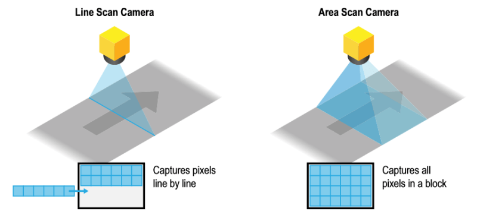
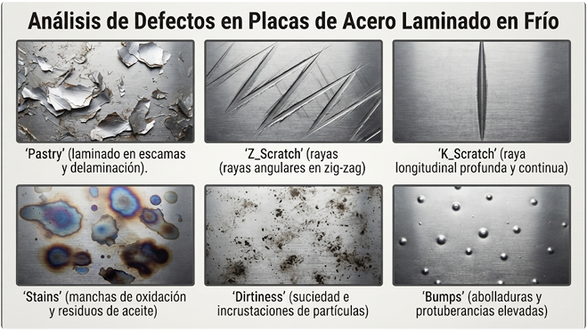
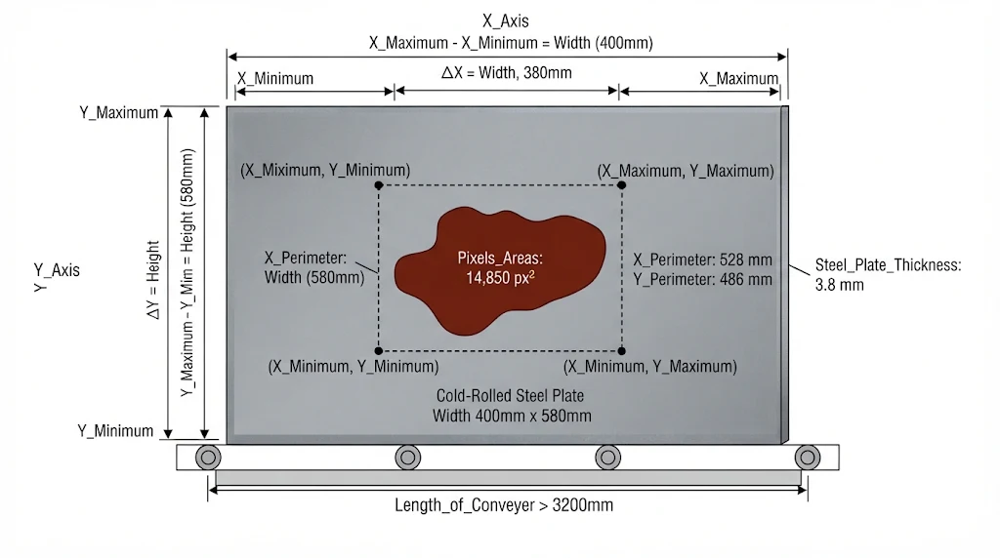
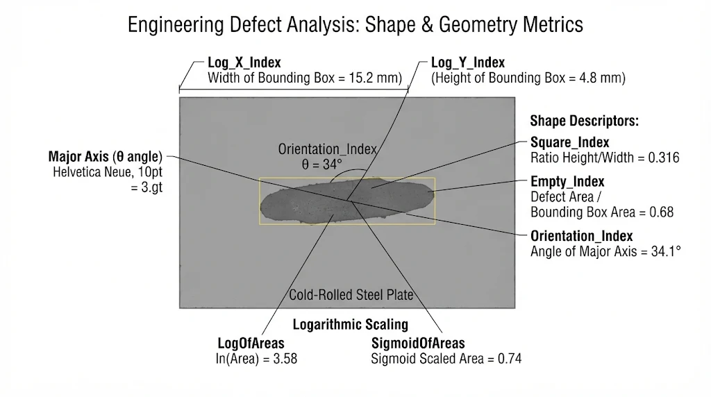
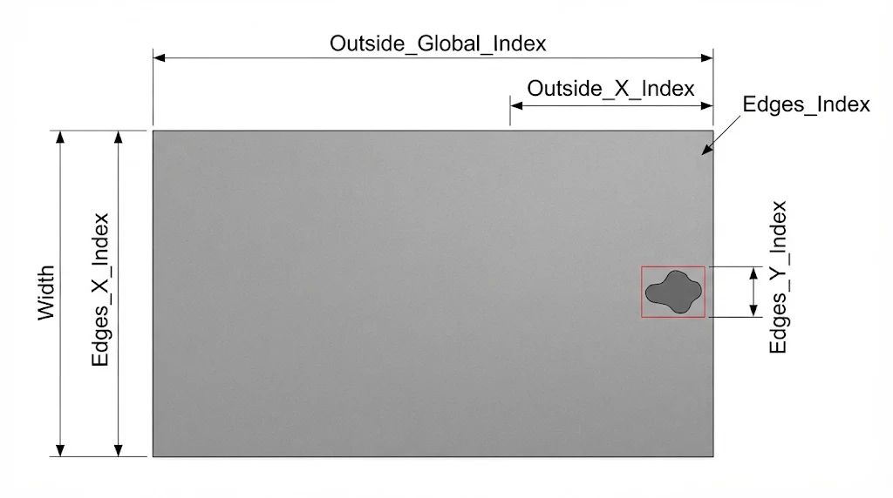
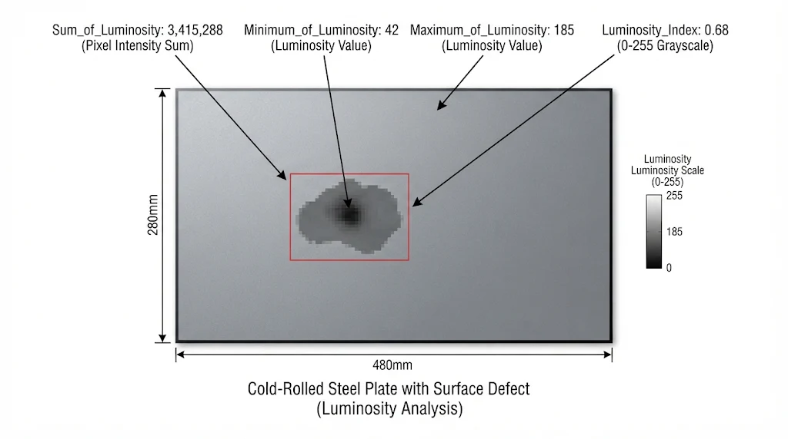
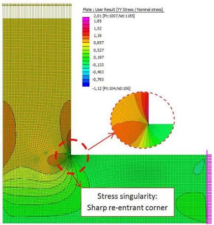

# Identificación de fallas en muestras de acero

- **Estudiantes:** Bastián Araya y Melisa González
- **Profesoras:** Isidora Abasolo y Marcela Rivera
- **Institución:** Facultad de Ingeniería — Departamento de Ingeniería Informática
- **Curso:** TIC I — Minor en Ciencias de Datos

---

## Introducción

Los datos **“Steel Plates Faults”** del repositorio de UCI, obtenidos por el centro de investigación Semeion, recopilan muestras de fallas en placas de acero y sus características.

La base de datos contiene **1.941 observaciones** de diferentes defectos superficiales en acero **A300** y **A400**. Su objetivo principal es facilitar el reconocimiento de patrones y la clasificación automática de siete categorías de fallas (`Pastry`, `Z_Scratch`, `K_Scatch`, `Stains`, `Dirtiness`, `Bumps` y `Other_Faults`) a partir de mediciones e índices geométricos y de luminosidad capturados en el proceso de inspección.

El conjunto de datos permite analizar cómo las distintas fallas se describen mediante índices normalizados de tamaño, forma y luminosidad, caracterizando con estadística descriptiva qué índices presentan mayor correlación con cada tipo de falla y en qué rangos de magnitud se manifiestan.

*Fuente: Adaptado de documentación técnica de visión artificial industrial (Keyence Corporation).*

---

## Variables del Dataset

### Variables dependientes (Tipos de fallas)
- `Pastry` (laminado en escamas y delaminación)
- `Z_Scratch` (rayas angulares en zig-zag)
- `K_Scratch` (raya longitudinal profunda y continua)
- `Stains` (manchas de oxidación y residuos de aceite)
- `Dirtiness` (suciedad e incrustaciones de partículas)
- `Bumps` (abolladuras y protuberancias elevadas)
- `Other_Faults` (otras fallas)

*Fuente: Elaboración propia mediante generación de imágenes con Gemini (Google).*

### Tabla 1: Características geométricas y operativas (Variables independientes)

| Variable | Qué representa | Cómo se obtiene |
| :--- | :--- | :--- |
| `X_Minimum` / `X_Maximum` | Límites izquierdo y derecho del defecto en el ancho transversal de la lámina `[px]`. | Coordenadas extremas en el eje X del *bounding box* del defecto. |
| `Y_Minimum` / `Y_Maximum` | Límites inferior y superior del defecto a lo largo del avance longitudinal de la bobina `[px]`. | Coordenadas extremas en el eje Y del *bounding box* en la línea de laminación. |
| `Pixels_Areas` | Tamaño superficial total del defecto `[px²]`. | Conteo de píxeles activos que forman el componente conexo ($A$). |
| `X_Perimeter` / `Y_Perimeter` | Proyección horizontal y vertical del contorno cerrado del defecto `[px]`. | Suma de desplazamientos unitarios horizontales y verticales al recorrer el perímetro. |
| `Length_of_Conveyer` | Ancho total de referencia de la cinta transportadora o campo transversal `[px]`. | Parámetro físico de calibración de la cámara *line-scan* en el eje X. |
| `Steel_Plate_Thickness` | Espesor nominal de la placa `[mm]`. | Dato operativo del proceso registrado. |

*Fuente: Elaboración propia mediante generación de imágenes con Gemini (Google).*

### Tabla 2: Índices de forma y escalamiento

| Variable | Qué representa | Cómo se obtiene |
| :--- | :--- | :--- |
| `Empty_Index` | Fracción de espacio vacío dentro del rectángulo envolvente `[0, 1]`. | $1 - \frac{\text{Pixels Areas}}{\Delta X \cdot \Delta Y}$ |
| `Square_Index` | Grado de simetría o compacidad del *bounding box*. | $\frac{\min(\Delta X, \Delta Y)}{\max(\Delta X, \Delta Y)}$ |
| `Orientation_Index` | Índice de elongación o asimetría direccional (`1` vertical, `-1` horizontal). | $1 - \frac{\Delta X}{\Delta Y}$ (cuando $\Delta Y > \Delta X$) |
| `LogOfAreas` | Magnitud superficial comprimida en escala logarítmica. | $\log_{10}(\text{Pixels Areas})$ |
| `Log_X_Index` / `Log_Y_Index` | Dimensiones netas del cuadro delimitador en escala logarítmica. | $\log_{10}(\Delta X)$ y $\log_{10}(\Delta Y)$ |
| `SigmoidOfAreas` | Área del defecto normalizada no linealmente en `[0, 1]`. | Transformación sigmoide sobre el área escalada. |

*Fuente: Elaboración propia mediante generación de imágenes con Gemini (Google).*

### Tabla 3: Índices de posición y bordes

| Variable | Qué representa | Cómo se obtiene |
| :--- | :--- | :--- |
| `Outside_X_Index` | Fracción del ancho total de inspección transversal ocupada por el defecto `[0, 1]`. | $\frac{\Delta X}{\text{Length of Conveyer}}$ |
| `Outside_Global_Index` | Clasificador discreto ternario `{0; 0.5; 1}` de dominancia axial. | `0` si $\Delta X > \Delta Y$; `0.5` si $\Delta X = \Delta Y$; `1` si $\Delta Y > \Delta X$. |
| `Edges_Index` | Proximidad relativa del defecto hacia los márgenes de la placa (`0` = cerca del borde). | Distancia normalizada entre la posición transversal y los límites laterales. |
| `Edges_X_Index` | Relación entre ancho neto del *bounding box* y proyección horizontal del perímetro `[0, 1]`. | $\frac{\Delta X}{\text{X Perimeter}}$ |
| `Edges_Y_Index` | Relación entre altura neta del *bounding box* y proyección vertical del perímetro `[0, 1]`. | $\frac{\Delta Y}{\text{Y Perimeter}}$ |

*Fuente: Elaboración propia mediante generación de imágenes con Gemini (Google).*

### Tabla 4: Características de luminosidad

| Variable | Qué representa | Cómo se obtiene |
| :--- | :--- | :--- |
| `Sum_of_Luminosity` | Energía lumínica integrada dentro de la superficie del defecto. | $\sum_{i=1}^{A} I_i$ (suma de intensidad de grises). |
| `Minimum_of_Luminosity` | Punto más oscuro o de mayor absorción lumínica. | $\min(I_i)$ |
| `Maximum_of_Luminosity` | Punto más brillante del defecto. | $\max(I_i)$ |
| `Luminosity_Index` | Contraste relativo normalizado de intensidad promedio frente a referencia `[-1, 1]`. | $\frac{\text{Sum of Luminosity} / \text{Pixels Areas}}{128} - 1$ |

*Fuente: Elaboración propia mediante generación de imágenes con Gemini (Google).*

---

## Contexto del problema

En control de calidad de acero es crítico identificar las fallas con mayor probabilidad de provocar fractura. Las fallas con pérdida de material y geometría angular generan concentradores de esfuerzos elevados que pueden inducir quiebres tempranos y reducir la vida útil del material. Por ello, **las fallas prioritarias son `K_Scratch` (rayas profundas) y `Z_Scratch` (rasguños superficiales en zig-zag)**.

*Fuente: Análisis por Elementos Finitos (FEA) de singularidad de esfuerzos en esquina reentrante (FEA Solutions).*

---

## Objetivos

- **Objetivo General:** Encontrar la relación de variables independientes para identificar las fallas más críticas: `Z_Scratch` y `K_Scratch`.
- **Objetivos Específicos:**
  1. Realizar análisis univariable y bivariable de distintas características de fallas.
  2. Construir un análisis multivariable a partir de los hallazgos univariable y bivariable.
  3. Generar tests de hipótesis para validar estadísticamente el cumplimiento del objetivo principal.

---

## Análisis y Conclusión

- **Análisis univariado:** Predominan `Other_Faults` y `Bumps`, seguidas por `Z_Scratch` y `K_Scratch`, lo que respalda la relevancia de analizar estas dos últimas.
- **Análisis bivariado:** El tipo de acero, espesor de placa, índice de orientación e índice de borde en Y (`Edges_Y_Index`) diferencian a `Z_Scratch` y `K_Scratch` del resto.
- **Análisis multivariado:** El espesor de la placa es la variable que más separa las fallas. Existe un sesgo marcado por tipo de acero: `K_Scratch` ocurre casi exclusivamente en **A400** (salvo un dato), mientras que la mayoría de `Z_Scratch` ocurre en **A300**.
- **Tests de hipótesis:** Validan estadísticamente los patrones observados, confirmando que el espesor de placa y `Edges_Y_Index` actúan como indicadores determinantes para diferenciar `Z_Scratch` y `K_Scratch`, condicionado al conocimiento previo del tipo de acero.

---

## Bibliografía

- Buscema, M., Terzi, S., & Tastle, W. (2010). *A New Meta-Classifier*. NAFIPS 2010, IEEE, pp. 1–7.
- Gonzalez, R. C., & Woods, R. E. (2018). *Digital Image Processing* (4th ed.). Pearson.
- Neogi, N., Mohanta, D. K., & Dutta, P. K. (2014). *Review of vision-based steel surface inspection systems*. EURASIP Journal on Image and Video Processing, 2014(1), Artículo 50. https://doi.org/10.1186/1687-5281-2014-50
- UCI Machine Learning Repository (2010). *Steel Plates Faults Data Set* (ID: 198). Semeion Research Center of Sciences of Communication, Rome, Italy.
- Keyence Corporation. *Line Scan Camera vs. Area Scan Camera — Machine Vision Basics*. https://www.keyence.com/
- FEA Solutions. *Stress Singularities and Sharp Re-entrant Corners in Finite Element Analysis*. https://www.fea-solutions.co.uk/
